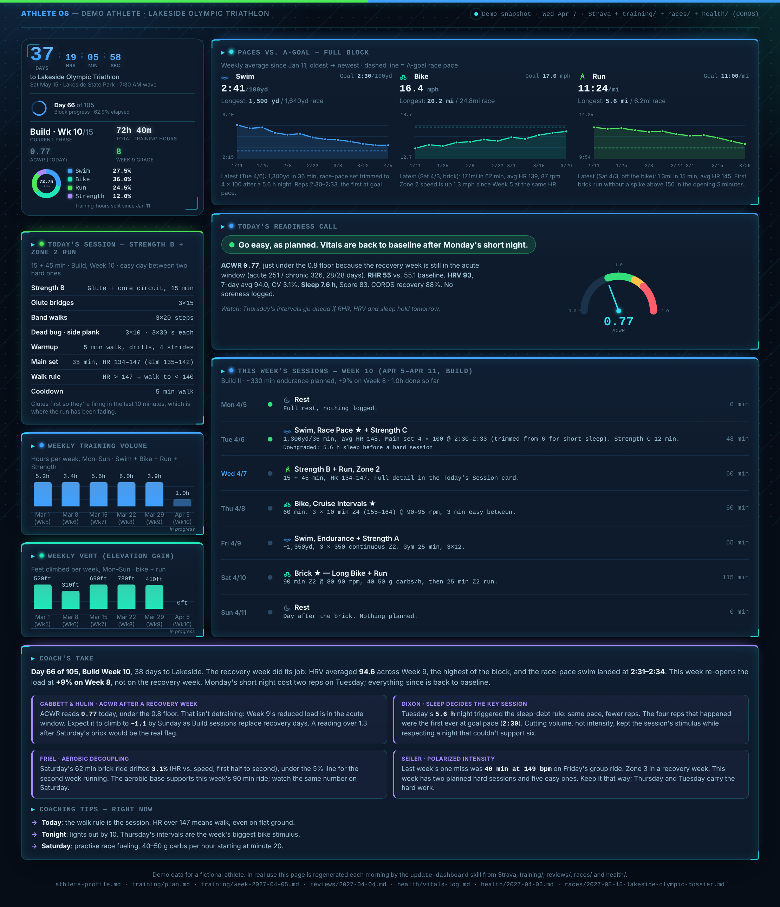

# Athlete OS

A personal triathlon coaching system built on [Claude Code](https://claude.com/claude-code).
It reads live training data from Strava and recovery data from a COROS watch,
plans each training week, makes a daily go-hard / go-easy / rest call, grades
every completed week, and keeps a dashboard up to date, all grounded in
published sports-science thresholds rather than generic plans.

I built it to train for my first Olympic-distance triathlon and used it
throughout a 15-week training block, through race day.



> Everything in this repo's data folders (`athlete-profile.md`, `training/`,
> `reviews/`, `health/`, `races/`, `dashboard.html`) is **demo data for a
> fictional athlete**. My real training data stays private.

---

## How it works

```
                ┌──────────────┐        ┌──────────────────┐
  Strava API ──▶│              │◀── MCP ─│ COROS watch      │
  (activities)  │  Claude Code │        │ (RHR, HRV, sleep, │
                │   + skills   │──────▶ │  scheduled        │
  Markdown  ◀──▶│              │  MCP   │  workouts)        │
  files (memory)└──────┬───────┘        └──────────────────┘
                       │
         ┌─────────────┼───────────────┐
         ▼             ▼               ▼
   dashboard.html   Gmail brief    training/, reviews/,
   (refreshed       (every          health/ (append-only
    each morning)    morning)        history)
```

- **Claude Code is the runtime.** Each capability is a *skill*
  (`.claude/skills/*/SKILL.md`): a written procedure with the coaching rules,
  the research behind them, and embedded Python for the parts that need exact
  math.
- **Markdown files are the memory.** The athlete profile, macro plan, weekly
  plans, reviews and daily vitals live in plain files, so every session starts
  from where training actually is. History is append-only.
- **Strava is the source of truth for training.** Skills pull it live through
  the API with an OAuth refresh token; nothing is copied into a database.
- **COROS is connected over MCP.** Morning vitals are pulled automatically,
  and approved runs and rides are pushed to the watch's calendar with HR
  targets.
- **Scheduled tasks** run the daily brief and the dashboard refresh every
  morning without anyone at the keyboard. Skills have explicit unattended
  behavior: they never block on a missing input, and they say what they
  couldn't get.

## Skills

| Skill | What it does |
|-------|--------------|
| [`plan-my-week`](.claude/skills/plan-my-week/SKILL.md) | Builds the coming week from the macro plan and last week's actual Strava data. Enforces polarized 80/20 intensity, 48 h between hard sessions, the 10% volume rule (ramping from actual, not planned, volume), recovery weeks and taper rules. After approval, sends runs and rides to the COROS watch. |
| [`recovery-check`](.claude/skills/recovery-check/SKILL.md) | Morning readiness call. Computes the acute:chronic workload ratio from 42 days of Strava load, reads RHR/HRV trends against the athlete's own baseline, and applies a fixed precedence ladder (injury/medical > sustained HRV/RHR > ACWR > sleep debt > plan) to output Go hard, Go easy or Rest with the evidence. Writes a flag file only when something real fires. |
| [`daily-brief`](.claude/skills/daily-brief/SKILL.md) | Five-line morning email: today's session and why, readiness call, latest week grade, race countdown, one focus line. Runs on a schedule. |
| [`weekly-review`](.claude/skills/weekly-review/SKILL.md) | Planned-vs-actual table, zone-compliance analysis, HRV/sleep fatigue read, a multi-week overtraining scan, an A–F grade with a rubric, and 1–2 adjustments for next week. Asks how the week felt and calls out gaps between feel and data. |
| [`fuel-and-pace`](.claude/skills/fuel-and-pace/SKILL.md) | Race-day fueling (carbs, fluid, sodium) and segment-by-segment pacing from the course dossier. Every number is labeled as measured or estimated, with the formula shown. |
| [`update-dashboard`](.claude/skills/update-dashboard/SKILL.md) | Regenerates the data in `dashboard.html` in place each morning without touching its design. |
| [`email-me`](.claude/skills/email-me/SKILL.md) | Sends HTML email through Gmail SMTP. Used by `daily-brief`. |

Plus [`parse_strength_fit.py`](.claude/scripts/parse_strength_fit.py), which
reads per-set weight and reps out of COROS strength-training `.fit` files
(COROS's files break `fitparse`, so it uses `fitdecode`).

## Design decisions

- **Rules come from the literature, with their caveats.** ACWR thresholds
  (Gabbett 2016, Hulin 2016), HRV trend reading (Plews 2013), overtraining
  markers (Meeusen 2013), carbohydrate oxidation limits (Jeukendrup 2010) and
  sweat sodium ranges (Baker 2017) are cited in the skills. So are the
  critiques, e.g. Impellizzeri 2020 on ACWR, which is why ACWR is treated as a
  directional signal and never the sole reason for a call.
- **One precedence ladder, shared.** `recovery-check`, `daily-brief` and
  `update-dashboard` all use the same ordered rules, so the email, the
  dashboard and an on-demand check can't disagree.
- **Proprietary metrics corroborate, never decide.** COROS Recovery % and
  Sleep Score appear as context only, because their algorithms aren't
  published.
- **Signal, not noise.** Flag files are written only when a threshold fires;
  quiet days produce no file, so the health history is readable.
- **Human approval before anything leaves the repo.** Weekly plans are
  confirmed before workouts are sent to the watch.

## What came out of it

Over a 15-week block the system produced 15 weekly plans, 15 graded reviews,
~100 days of vitals and readiness calls, a race dossier, a fueling and pacing
plan, and a post-race analysis. The race went faster than every projection it
made.

## Setup

1. Install [Claude Code](https://claude.com/claude-code) and clone this repo.
2. `pip install -r requirements.txt`
3. Copy `.env.example` to `.env` and add Strava API credentials (and Gmail
   app-password credentials if you want the email brief).
4. Connect the COROS MCP server (`.mcp.json` is included) and authenticate.
5. Replace the demo `athlete-profile.md`, `training/plan.md` and race dossier
   with your own, and clear the demo files in `training/`, `reviews/` and
   `health/`.
6. Open the folder in Claude Code and ask to "plan my week".

Skills resolve files relative to the project root. Set `ATHLETE_OS_ROOT` if
you run the scripts from somewhere else.

## Repo layout

```
CLAUDE.md               how Claude coaches: rules loaded every session
athlete-profile.md      goals, zones, constraints, coaching philosophy (demo)
dashboard.html          self-contained dashboard (demo data)
training/plan.md        15-week macro plan (demo)
training/week-*.md      weekly plans written by plan-my-week (demo)
reviews/*.md            weekly reviews written by weekly-review (demo)
health/vitals-log.md    daily RHR / HRV / sleep from COROS (demo)
health/YYYY-MM-DD.md    readiness flags, only on days something fired (demo)
races/                  race dossier (demo)
.claude/skills/         the skills
.claude/scripts/        helper scripts
```

## Built with

Claude Code wrote much of the code and prose in this repo. I designed the
system: what each skill is responsible for, which rules it enforces and in
what order, how the pieces share state, and when a human has to approve. I
then used it daily and kept refining the skills when their output was wrong.
